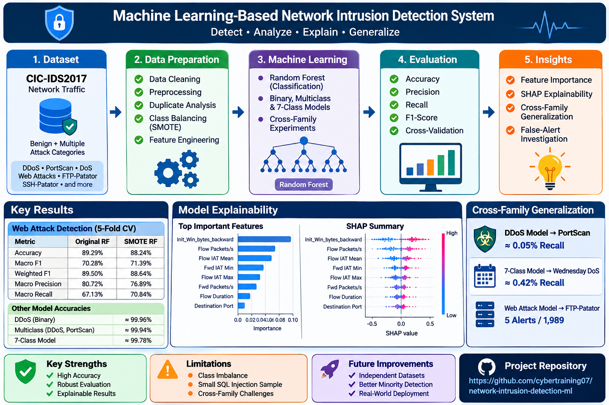

# Machine Learning-Based Network Intrusion Detection System

A cybersecurity and machine learning research project using the **CIC-IDS2017 dataset** to develop, evaluate, and investigate machine-learning models for network intrusion detection.

## Project Overview

This project explores how machine-learning techniques can identify benign network traffic and malicious activity.

The work includes binary and multiclass classification, model comparison, class-imbalance investigation, feature importance, SHAP explainability, and cross-family generalization experiments.

A key focus is understanding not only model accuracy, but also how well models recognize attack categories that were not represented in their original training classes.

**Project status:** Experimental research and portfolio project. Models have not been validated for production deployment.

## Results Summary

The project evaluated multiple Random Forest intrusion detection models using CIC-IDS2017 traffic data.

| Experiment | Reported Result |
|---|---:|
| Binary DDoS detection | 99.96% accuracy |
| BENIGN / DDoS / PortScan classification | 99.94% accuracy |
| Seven-class intrusion classification | 99.78% accuracy |
| Web Attack original Random Forest | 89.29% five-fold CV accuracy |
| Web Attack with SMOTE | 88.24% five-fold CV accuracy |

### Key Evaluation Findings

- SMOTE improved Web Attack macro F1 from 70.28% to 71.39%, while overall accuracy decreased.
- Cross-family testing exposed poor recognition of some attack types not adequately represented during training.
- The DDoS model achieved approximately 0.05% recall against PortScan traffic.
- The seven-class model achieved approximately 0.42% recall against Wednesday DoS traffic.
- The Web Attack model generated 5 alerts among 1,989 FTP-Patator records.

### Interpretation

High accuracy on a test split does not guarantee reliable detection of previously unseen attack families. These experiments highlight the importance of class-level metrics, independent testing, class imbalance analysis, and cross-family evaluation.

The results are experimental and should not be interpreted as production-ready detection performance.

## Project Objectives

- Explore and preprocess CIC-IDS2017 network traffic data.
- Develop binary and multiclass intrusion detection models.
- Train and compare Random Forest classifiers.
- Investigate duplicate records and class imbalance.
- Evaluate SMOTE for minority-class handling.
- Analyze important network traffic features.
- Apply SHAP to investigate model predictions.
- Evaluate cross-family attack generalization.
- Investigate a second-stage approach to reducing false alerts.

## Dataset

The project uses the **CIC-IDS2017 dataset**, which contains benign traffic and multiple categories of simulated cyberattacks.

Attack categories explored include:

- DDoS
- PortScan
- DoS Hulk
- DoS GoldenEye
- DoS Slowloris
- DoS Slowhttptest
- FTP-Patator
- SSH-Patator
- Bot
- Web Attack Brute Force
- Web Attack XSS
- Web Attack SQL Injection
- Infiltration
- Heartbleed

Network-flow features include packet counts, flow duration, packet lengths, inter-arrival times, TCP window information, and packet rates.

The original dataset is not included in this repository because of its size.

## Technologies and Tools

| Technology | Purpose |
|---|---|
| Python 3.12 | Development |
| Pandas | Data processing |
| NumPy | Numerical operations |
| Scikit-learn | Machine learning |
| Random Forest | Classification |
| Imbalanced-learn | SMOTE and class balancing |
| Matplotlib | Visualization |
| Seaborn | Statistical visualization |
| SHAP | Model explainability |
| Joblib | Model persistence |
| Kali Linux | Development environment |
| Git and GitHub | Version control |

## Project Workflow

1. Dataset inspection and exploration.
2. Data cleaning and preprocessing.
3. Duplicate-record investigation.
4. Dataset preparation and class distribution analysis.
5. Binary and multiclass model training.
6. Model evaluation and comparison.
7. Feature importance and SHAP analysis.
8. Cross-family generalization testing.
9. False-alert investigation.
10. Documentation and visualization.

## Machine Learning Experiments

### 1. Binary DDoS Detection

A Random Forest classifier was trained to distinguish benign network traffic from DDoS traffic.

- Cleaned dataset: 39,771 records.
- Evaluation: Random train/test split.
- Reported test accuracy: approximately **99.96%**.

### 2. Multiclass Intrusion Detection

A three-class model was developed to classify:

- BENIGN
- DDoS
- PortScan

Reported random test-split accuracy: approximately **99.94%**.

### 3. Seven-Class Intrusion Detection

A seven-class Random Forest model was trained using selected DDoS, PortScan, and Wednesday DoS traffic categories.

Reported random test-split accuracy: approximately **99.78%**.

### 4. Web Attack Detection

A dedicated classifier was developed for:

- BENIGN
- Web Attack Brute Force
- Web Attack XSS
- Web Attack SQL Injection

Three approaches were investigated:

- Original Random Forest
- Improved Random Forest
- Random Forest with SMOTE

#### Five-fold cross-validation comparison

| Metric | Original RF | SMOTE RF |
|---|---:|---:|
| Accuracy | 89.29% | 88.24% |
| Macro F1 | 70.28% | 71.39% |
| Weighted F1 | 89.50% | 88.64% |
| Macro Precision | 80.72% | 76.89% |
| Macro Recall | 67.13% | 70.84% |

SMOTE improved macro F1 and macro recall, while the original model achieved higher accuracy and weighted F1.

The SQL Injection class contained only 21 records, making performance estimates for this class highly uncertain.

## Model Explainability

Feature importance and SHAP were used to investigate which network-flow characteristics influenced model predictions.

Important features identified included:

- Init_Win_bytes_backward
- Flow Packets/s
- Flow IAT Mean
- Fwd IAT Min
- Flow IAT Max
- Fwd Packets/s
- Flow Duration
- Destination Port

These results show model associations and should not be interpreted as proof of causation or universal indicators of malicious activity.

## Cross-Family Generalization

Cross-family experiments investigated whether models trained on particular attack categories could recognize different attack families.

### DDoS Model Against PortScan

The DDoS model achieved approximately **0.05% PortScan recall** in the cross-family evaluation.

This indicates that learning to recognize DDoS traffic did not automatically enable the model to recognize PortScan activity.

### Seven-Class Model Against Wednesday DoS Traffic

The model achieved approximately **0.42% attack recall** in the binary evaluation of the separate Wednesday dataset.

### Web Attack Model Against FTP-Patator

The original Web Attack classifier was also evaluated against FTP-Patator traffic to investigate cross-family false alerts and classification behavior.

The experiment highlighted the importance of evaluating intrusion detection models against traffic from attack families outside their training categories.

## False-Alert Investigation

Additional experiments investigated SSH and FTP classification behavior.

A second-stage classification approach was explored to examine whether suspicious predictions from an initial model could be further analyzed.

These experiments were treated as investigative research rather than proof of a reliable false-positive reduction system. In particular, pseudo-label-based training does not provide independent ground-truth validation.

## Visualizations

The repository includes selected project visualizations:

- `feature_importance.png` — feature importance visualization.
- `ftp_crossfamily_comparison.png` — FTP cross-family comparison.

## Repository Structure

```text
network-intrusion-detection-ml/
│
├── README.md
├── requirements.txt
├── .gitignore
│
├── prepare_*.py
├── train_*.py
├── evaluate_*.py
├── compare_*.py
├── investigate_*.py
├── analyze_*.py
├── inspect_*.py
├── plot_*.py
│
├── feature_importance.png
└── ftp_crossfamily_comparison.png
```

The Python scripts cover dataset preparation, model training, evaluation, comparison, investigation, and visualization.

## Installation

Clone the repository:

```bash
git clone https://github.com/cybertraining07/network-intrusion-detection-ml.git
```

Enter the project directory:

```bash
cd network-intrusion-detection-ml
```

Create a virtual environment:

```bash
python3 -m venv .venv
```

Activate it on Linux:

```bash
source .venv/bin/activate
```

Install dependencies:

```bash
pip install -r requirements.txt
```

## Dataset Requirements

Download the CIC-IDS2017 dataset from its official source:

https://www.unb.ca/cic/datasets/ids-2017.html

Place the extracted dataset files in the expected local dataset directory before running the relevant preparation scripts.

The original dataset, generated CSV files, and trained model artifacts are excluded from this GitHub repository.

## Important Limitations

- Random train/test splits can produce optimistic results when similar traffic records appear in both training and testing data.
- High accuracy does not necessarily mean strong attack detection.
- Cross-family experiments demonstrate limitations in recognizing unseen attack categories.
- Severe class imbalance affects minority-class performance.
- The SQL Injection sample count is particularly small.
- Pseudo-label-based second-stage experiments require independent ground-truth validation.
- Additional testing on independent datasets and realistic network environments is required.

The reported results should therefore be interpreted as experimental findings, not evidence of production-ready intrusion detection.

## Future Improvements

- Evaluate models using independent datasets.
- Introduce group-aware or time-aware validation where suitable.
- Improve minority-class detection.
- Investigate additional algorithms and ensemble approaches.
- Explore anomaly detection for previously unseen attacks.
- Improve model explainability and error analysis.
- Develop a reproducible end-to-end training and evaluation pipeline.
- Explore deployment through a controlled network monitoring environment.

## Author's Project Focus

This project demonstrates practical exploration of:

- Machine learning for cybersecurity.
- Network intrusion detection.
- Python-based data engineering.
- Model training and evaluation.
- Feature engineering and explainability.
- Class imbalance and generalization analysis.
- Experimental documentation and reproducibility.

**GitHub Repository:**  
https://github.com/cybertraining07/network-intrusion-detection-ml

## System Architecture

The diagram below summarizes the end-to-end workflow, from CIC-IDS2017 data preparation through model training, evaluation, and explainability.


