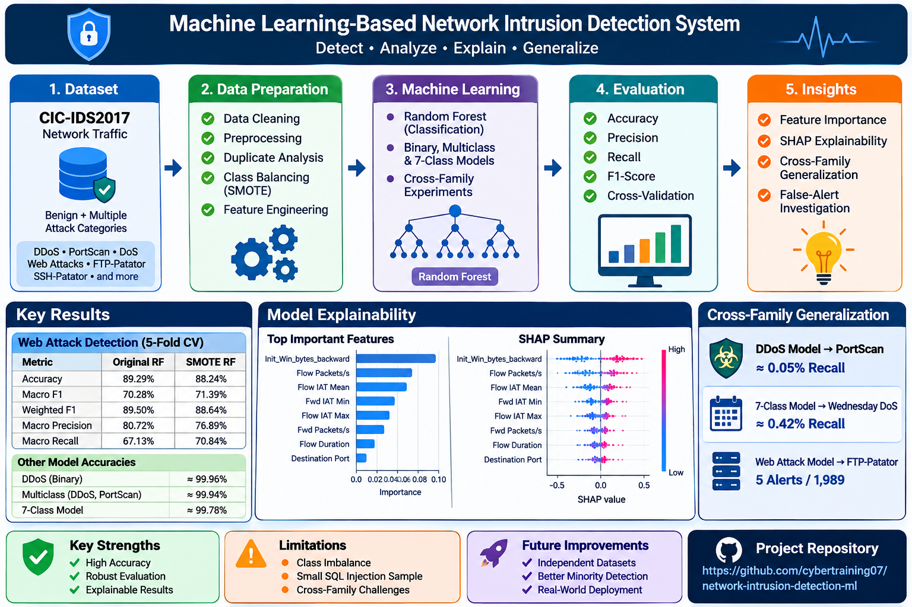
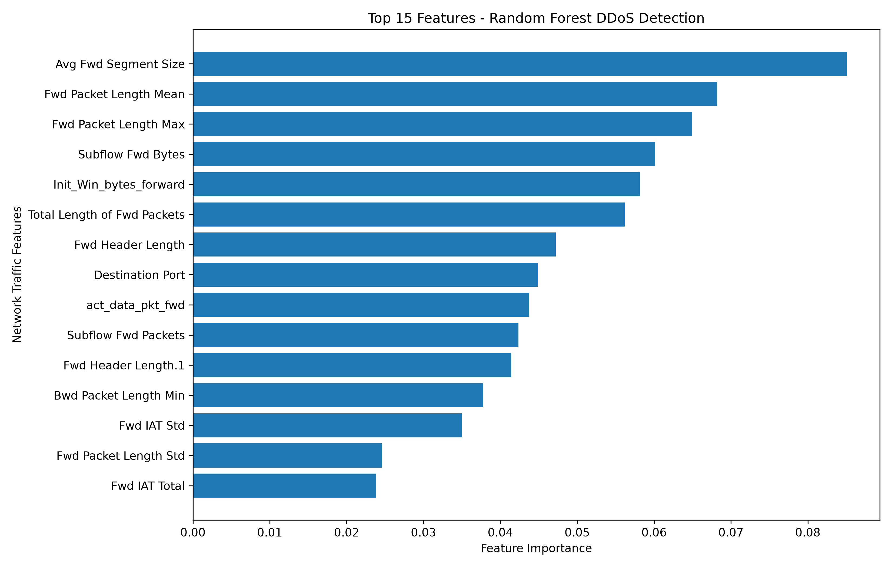
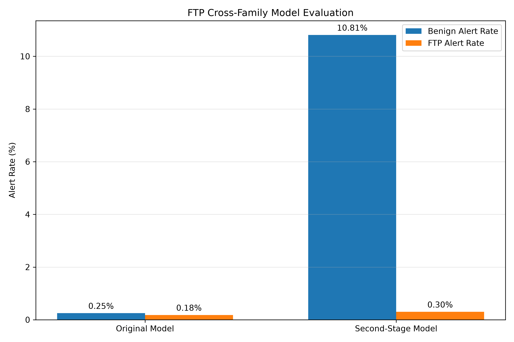

# Machine Learning-Based Network Intrusion Detection System

## Project Overview

**Project Category:** Machine Learning Engineering / Cybersecurity  
**Dataset:** CIC-IDS2017  
**Primary Algorithm:** Random Forest  
**Programming Language:** Python  
**Environment:** Kali Linux  
**Repository:** https://github.com/cybertraining07/network-intrusion-detection-ml

## 1. Project Objective

The objective of this project is to develop and evaluate machine learning models capable of identifying malicious network traffic using network-flow data.

The project investigates both conventional classification performance and the ability of models to recognize attack families that were not represented in their original training categories.

## 2. Technical Stack

- Python
- Pandas and NumPy
- Scikit-learn
- Imbalanced-learn
- SHAP
- Matplotlib
- Joblib
- Git and GitHub
- CIC-IDS2017 dataset

## 3. System Architecture

The project follows a machine learning workflow:

1. CIC-IDS2017 dataset acquisition.
2. Data inspection and preprocessing.
3. Feature preparation and dataset balancing.
4. Model training using Random Forest.
5. Binary and multiclass classification.
6. Cross-attack-family evaluation.
7. Feature-importance and SHAP analysis.
8. Performance reporting and documentation.

## 4. Model Development

### Binary DDoS Detection

A Random Forest model was trained to distinguish BENIGN traffic from DDoS traffic.

- Dataset: 40,000 records.
- Training records: 32,000.
- Testing records: 8,000.
- Accuracy: 99.9375%.

### Multiclass Intrusion Detection

A three-class Random Forest classifier was developed to recognize:

- BENIGN
- DDoS
- PortScan

Results:

- Testing records: 8,732.
- Correct predictions: 8,727.
- Accuracy: 99.94%.

### Cross-Family Evaluation

Additional experiments investigated generalization to traffic from different attack families, including:

- PortScan
- FTP-Patator
- SSH-Patator
- Other attack traffic in the cross-family test dataset.

These experiments demonstrated that strong random-split accuracy does not necessarily translate into reliable detection of unseen attack families.

## 5. Explainability and Feature Analysis

Feature-importance analysis and SHAP were used to investigate the contribution of network-flow characteristics to model predictions.

Features investigated included:

- Flow Duration
- Flow Packets/s
- Flow IAT Mean
- Flow IAT Max
- Forward and backward packet statistics.

## 6. Cross-Family Performance Analysis

The Web Attack models were compared using cross-family evaluation.

The SMOTE Random Forest achieved the strongest F1 score among the three evaluated Web Attack models, although overall cross-family detection remained weak.

## 7. Engineering Challenges

The project involved practical machine learning and cybersecurity challenges:

- Handling large network-flow datasets.
- Managing class distributions and imbalanced attack categories.
- Comparing binary and multiclass models.
- Investigating false alerts and missed attacks.
- Evaluating cross-family generalization.
- Interpreting model predictions with SHAP.
- Maintaining reproducible scripts and version-controlled documentation.

## 8. Key Lessons

The experiments reinforced several important lessons:

1. Accuracy alone is insufficient for evaluating intrusion detection systems.
2. Recall and F1 score are important when missed attacks carry security consequences.
3. Cross-family testing is essential for understanding model generalization.
4. Explainability tools help investigate model behavior.
5. Models trained on their own predictions do not automatically improve detection quality.

## 9. Future Development

Planned improvements include:

- Expanding training to additional attack families.
- Conducting independent attack-family-separated testing.
- Comparing additional algorithms.
- Improving minority-class detection.
- Developing a real-time network intrusion detection prototype.

## 10. Repository

Source code, scripts, documentation, and project updates:

https://github.com/cybertraining07/network-intrusion-detection-ml

## Conclusion

This project demonstrates practical experience with machine learning workflows, cybersecurity datasets, intrusion detection, model evaluation, explainability, error analysis, and Git-based project management.
