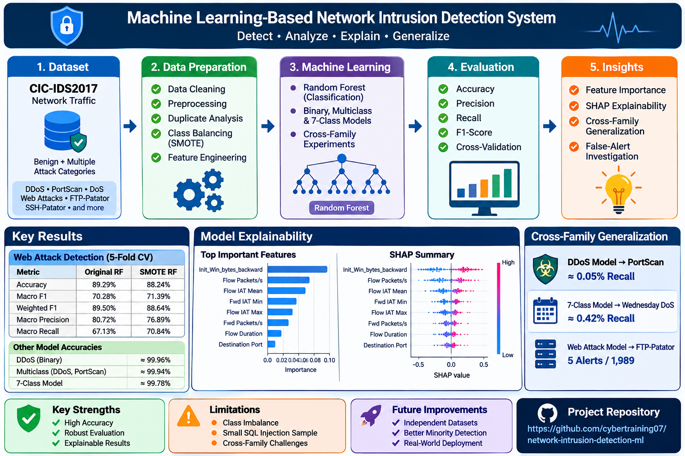
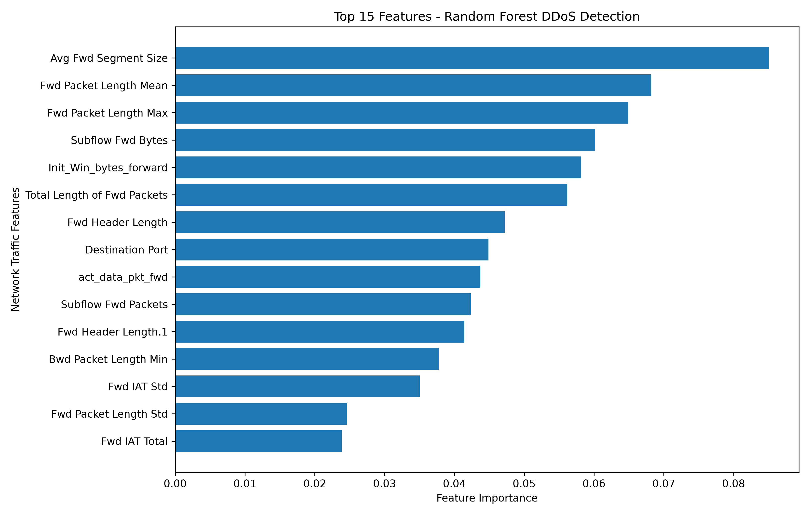
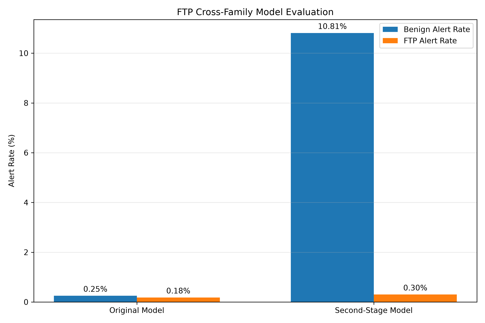

# Network Intrusion Detection – ML Engineering Portfolio

A practical machine learning and cybersecurity project using the CIC-IDS2017 dataset to investigate network intrusion detection, model performance, explainability, and cross-attack-family generalization.

## Project at a Glance

| Item | Details |
|---|---|
| Project | Network Intrusion Detection |
| Domain | Machine Learning Engineering / Cybersecurity |
| Dataset | CIC-IDS2017 |
| Main Algorithm | Random Forest |
| Language | Python |
| Environment | Kali Linux |
| Repository | [GitHub Source Code](https://github.com/cybertraining07/network-intrusion-detection-ml) |

## Project Highlights

- Developed binary DDoS detection and multiclass intrusion classification models.
- Achieved 99.9375% accuracy on the binary DDoS random test split.
- Achieved 99.94% accuracy on the three-class random test split.
- Compared original, improved, and SMOTE Random Forest models.
- Investigated PortScan, FTP-Patator, and SSH-Patator cross-family performance.
- Applied SHAP and feature-importance analysis.
- Investigated false alerts and missed attack records.
- Documented experimental limitations and future improvements.

**Important:** High random-split accuracy did not translate into reliable detection of all unseen attack families. Cross-family results are included to demonstrate this limitation honestly.

## Portfolio Contents

| Document | Description |
|---|---|
| [Project Overview](PROJECT_OVERVIEW.md) | Project objective, technology stack, architecture, and findings |
| [Model Performance](MODEL_PERFORMANCE.md) | Model metrics and evaluation results |
| [Technical Methodology](TECHNICAL_METHODOLOGY.md) | Dataset preparation, training, testing, and explainability |

## Project Evidence

### System Architecture

### Feature Importance

### FTP Cross-Family Comparison

## Skills Demonstrated

- Python programming
- Data preprocessing and analysis
- Machine learning model development
- Random Forest classification
- Imbalanced dataset evaluation
- Cybersecurity traffic analysis
- Cross-family model testing
- SHAP explainability
- Performance reporting
- Git and GitHub

## Future Development

- Independent attack-family-separated testing.
- Evaluation of additional machine learning algorithms.
- Improved minority-class detection.
- Real-time intrusion detection prototype.
- Testing on additional network traffic datasets.

## Source Code

[View the complete project on GitHub](https://github.com/cybertraining07/network-intrusion-detection-ml)

## Disclaimer

This project is an educational and experimental machine learning study using the CIC-IDS2017 dataset. It is not a production-ready intrusion detection system.
